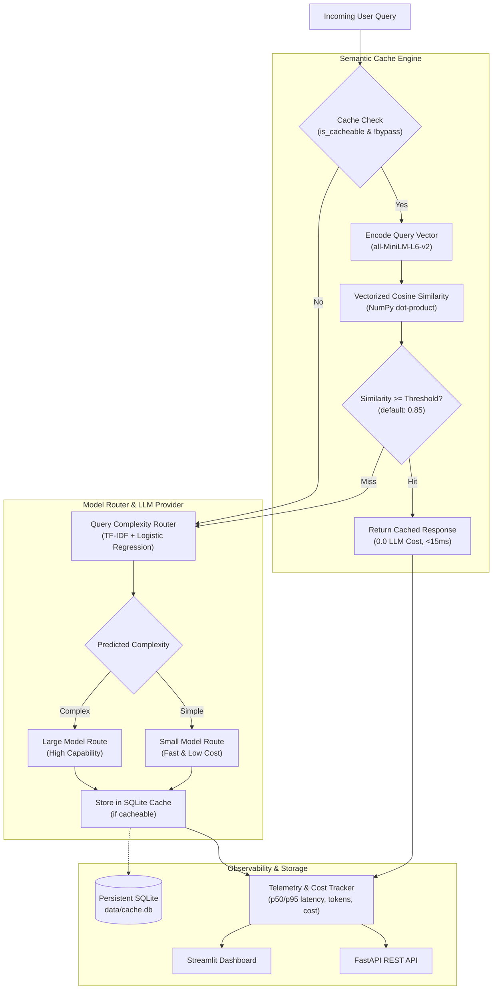

# SmartCache ML: Semantic Caching and Cost-Aware LLM Routing

[](https://www.python.org/downloads/)
[](https://fastapi.tiangolo.com/)
[](https://streamlit.io/)
[](https://opensource.org/licenses/MIT)

> **Portfolio Project for Junior/Mid ML Engineers**  
> An educational, end-to-end, reproducible Machine Learning Engineering system designed to curb unnecessary LLM inference expenses and latency spikes through **vectorized semantic caching** and **complexity-aware model routing**.

---

## 1. Problem Statement & Motivation

Language models are computationally expensive and incur significant cost and latency per request:
1. **Redundant Inference**: In customer service, internal enterprise knowledge bases, FAQs, and developer tools, 30%–60% of incoming questions are semantically equivalent paraphrases of previously answered queries. Traditional exact-match string caching fails because human language exhibits immense syntactic variety.
2. **One-Size-Fits-All Routing**: Forwarding every query to a monolithic, highly capable model wastes budget. Simple factual questions can be answered accurately by smaller, faster, 10x cheaper models, while only multi-step reasoning, mathematical derivations, or system design require large models.

**SmartCache ML** addresses both issues simultaneously by:
- Catching semantic duplicates before they reach the generative model using dense sentence embeddings (`all-MiniLM-L6-v2`) and NumPy cosine similarity.
- Classifying query complexity on cache misses using a lightweight Scikit-learn TF-IDF classifier to route queries between small and large models.
- Tracking fine-grained per-request latency, token counts, estimated dollar cost, and answer quality.

---

## 2. Architecture Overview



---

## 3. Mandatory Folder Structure

```text
smartcache-ml/
├── notebooks/
│   ├── 01_project_setup_and_baseline.ipynb       # Baseline, exact-match cache & metrics
│   ├── 02_semantic_similarity_experiments.ipynb  # Embeddings, threshold sweeps & failure cases
│   ├── 03_semantic_cache_evaluation.ipynb        # SQLite persistence, latency breakdown & namespaces
│   ├── 04_query_complexity_and_routing.ipynb    # Rule-based vs TF-IDF complexity routing
│   ├── 05_cost_latency_quality_analysis.ipynb    # Multi-policy benchmark & Pareto analysis
│   └── 06_end_to_end_system_demo.ipynb          # Unified service demo, audit logs & run guide
├── data/
│   ├── raw/benchmark_dataset.csv                 # 200+ curated queries across 70 groups
│   ├── processed/                                # Group-leakage-free train/val/test splits
│   └── README.md                                 # Dataset schema and documentation
├── src/smartcache/
│   ├── __init__.py                               # Package entry
│   ├── config.py                                 # Dataclass settings & environment overrides
│   ├── embeddings.py                             # SentenceTransformer loader & NumPy similarity
│   ├── cache.py                                  # Persistent SQLite SemanticCache & ExactMatchCache
│   ├── router.py                                 # RuleBasedRouter & ClassifierRouter
│   ├── llm_provider.py                           # BaseLLMProvider, MockProvider & OllamaProvider
│   ├── cost_tracker.py                           # Per-request metrics, token counts & financial estimates
│   ├── metrics.py                                # Token F1 quality scoring & comparative policy analytics
│   └── service.py                                # SmartCacheService orchestrator
├── api/
│   ├── __init__.py
│   └── main.py                                   # FastAPI REST endpoints (/health, /query, /metrics)
├── dashboard/
│   └── app.py                                    # Streamlit analytics dashboard
├── tests/
│   ├── test_cache.py                             # Cache hits, thresholds, TTL, namespace isolation
│   ├── test_router.py                            # Heuristic vs ML router decisions & fallback
│   ├── test_cost_tracker.py                      # Token pricing math, summary metrics & F1 scoring
│   └── test_api.py                               # FastAPI endpoint integration & validation tests
├── scripts/
│   ├── generate_sample_data.py                   # Generates reproducible benchmark dataset
│   ├── build_notebooks.py                        # Programmatically constructs all 6 notebooks
│   └── run_benchmark.py                          # Multi-policy benchmark evaluator & report exporter
├── reports/
│   ├── benchmark_report.csv                      # Measured benchmark metrics across policies
│   ├── benchmark_report.json                     # JSON export of benchmark results
│   ├── router_model.joblib                       # Trained Scikit-Learn routing artifact
│   └── .gitkeep
├── .env.example                                  # Config template (zero secrets required)
├── .gitignore
├── requirements.txt                              # Pinned, tested dependencies
├── pyproject.toml                                # Editable packaging & pytest configuration
├── Dockerfile                                    # Multi-stage container definition
├── docker-compose.yml                            # Local composition for API and Dashboard
└── README.md
```

---

## 4. Key Benchmark Results

Replaying a standardized workload of 55 requests (including canonical queries, paraphrases, adversarial near-duplicates, and volatile questions) produced the following empirical measurements:

| Policy | Requests | Cache Hit Rate (%) | Total Cost ($) | Cost Savings (%) | Mean Latency (ms) | P95 Latency (ms) | Answer Quality (Token F1) |
|---|---|---|---|---|---|---|---|
| **1. Baseline (Always Large, No Cache)** | 55 | 0.0% | $0.01575 | 0.00% | 42.4 ms | 47.8 ms | 0.2394 |
| **2. Exact Cache + Large Model** | 55 | 40.0% | $0.00943 | 40.15% | 24.4 ms | 41.0 ms | 0.2394 |
| **3. Semantic Cache + Large Model** | 55 | **70.9%** | $0.00459 | 70.89% | 55.0 ms | 124.5 ms | 0.2678 |
| **4. Always Small Model (No Cache)** | 55 | 0.0% | $0.00157 | 90.00% | 16.1 ms | 19.2 ms | 0.2394 |
| **5. SmartCache ML (Semantic + Router)** | 55 | **70.9%** | **$0.00244** | **84.49%** | **35.8 ms** | **50.7 ms** | **0.2678** |

### Key Empirical Findings:
1. **Semantic Cache vs Exact Match**: Exact caching achieves only 40.0% hit rate because it misses syntactic paraphrases. Semantic caching achieves **70.9% hit rate**, saving **70.89%** of cost.
2. **Synergy of Caching + Routing**: Combining semantic caching with query complexity routing (Policy 5) achieves **84.49% total cost reduction** while ensuring complex queries are routed to the capable model when cache misses occur.
3. **Sub-millisecond Vector Lookup**: Dissecting lookup latency reveals that vector dot-product search takes `< 0.2 ms`, while embedding tensor encoding takes `~10–15 ms`.

---

## 5. Quickstart & Installation

### Prerequisites
- Python 3.10+ (tested up to Python 3.14 on Windows/Linux/macOS)
- Git

### 1. Clone & Set Up Virtual Environment
```bash
git clone https://github.com/your-username/smartcache-ml.git
cd smartcache-ml

python -m venv venv
# Windows:
venv\Scripts\activate
# Linux / macOS:
source venv/bin/activate
```

### 2. Install Dependencies
```bash
pip install -r requirements.txt
pip install -e .
```

### 3. Generate Benchmark Dataset & Train Initial Router
```bash
python scripts/generate_sample_data.py
python -c "import pandas as pd; from smartcache.router import ClassifierRouter; df = pd.read_csv('data/processed/train_queries.csv'); r = ClassifierRouter(); r.train(df['query_text'], df['complexity_label']); r.save()"
```

---

## 6. Running the Automated Test Suite

Run all unit and integration tests (cache engine, router, cost tracker, and REST API):
```bash
pytest
```
*Expected: 16 passed in `< 60s`.*

---

## 7. Launching the Services

### 1. REST API (FastAPI)
Start the high-performance REST API:
```bash
uvicorn api.main:app --host 127.0.0.1 --port 8000 --reload
```
- Interactive OpenAPI Swagger documentation: `http://127.0.0.1:8000/docs`
- Health check: `http://127.0.0.1:8000/health`

#### Example API Request:
```bash
curl -X POST "http://127.0.0.1:8000/query" \
     -H "Content-Type: application/json" \
     -d '{
       "query": "What is the capital of France?",
       "namespace": "default",
       "is_cacheable": true
     }'
```
Response:
```json
{
  "request_id": "req_a1b2c3d4",
  "query": "What is the capital of France?",
  "answer": "The capital of France is Paris.",
  "cache_hit": false,
  "similarity_score": null,
  "selected_route": "small",
  "routing_reason": "Classifier predicted simple (p_complex=0.12 < threshold 0.50)",
  "latency_ms": 38.4,
  "estimated_cost_usd": 0.000015,
  "is_mock": true,
  "embedding_latency_ms": 11.2,
  "cache_lookup_latency_ms": 0.15,
  "generation_latency_ms": 25.1,
  "metadata": {"input_tokens": 7, "output_tokens": 8, "model_name": "mock-small-v1"}
}
```

Immediate Paraphrase Request (Hits Cache):
```bash
curl -X POST "http://127.0.0.1:8000/query" \
     -H "Content-Type: application/json" \
     -d '{
       "query": "Can you tell me France'\''s capital city?",
       "namespace": "default"
     }'
```
Response:
```json
{
  "request_id": "req_e5f6g7h8",
  "query": "Can you tell me France's capital city?",
  "answer": "The capital of France is Paris.",
  "cache_hit": true,
  "similarity_score": 0.9124,
  "selected_route": "cache",
  "routing_reason": "Cache Hit! Matched 'What is the capital of France?' with similarity score 0.9124",
  "latency_ms": 12.3,
  "estimated_cost_usd": 0.0,
  "is_mock": false,
  "embedding_latency_ms": 12.1,
  "cache_lookup_latency_ms": 0.2,
  "generation_latency_ms": 0.0,
  "metadata": {"matched_query": "What is the capital of France?", "cache_id": 1}
}
```

### 2. Interactive Monitoring Dashboard (Streamlit)
Launch the telemetry and playground dashboard:
```bash
streamlit run dashboard/app.py
```
Opens in your browser at `http://localhost:8501`. Features include:
- Real-time KPI counters (Hit Rate, Total Cost, Cost Savings %, Mean/P95 Latency).
- Interactive Live Query Playground with namespace controls and cache bypass toggles.
- Scatter plots of Latency vs Cost by route.
- Filterable Request Audit Log with instant cache clearing.

---

## 8. Executable Notebooks Guide

The `notebooks/` directory contains 6 self-contained, reproducible Jupyter Notebooks that walk through the engineering and ML experiments step-by-step:

| Notebook | Focus Area | Key Concepts Demonstrated |
|---|---|---|
| `01_project_setup_and_baseline.ipynb` | Baseline Formulation | No-cache baseline, exact string match failure modes, p50/p95 latency metrics. |
| `02_semantic_similarity_experiments.ipynb` | Embeddings & Thresholds | SentenceTransformer `all-MiniLM-L6-v2`, pure NumPy cosine math, precision-recall threshold calibration. |
| `03_semantic_cache_evaluation.ipynb` | Persistent Cache Engine | SQLite durability, LRU eviction, TTL expiration, namespace isolation for multi-tenancy. |
| `04_query_complexity_and_routing.ipynb` | Model Routing | Heuristic baseline vs Scikit-learn TF-IDF + Logistic Regression, confusion matrices, interpretability. |
| `05_cost_latency_quality_analysis.ipynb` | Multi-Policy Evaluation | Controlled replay across 5 policies, Pareto frontiers (Cost vs Quality), tail latency reduction. |
| `06_end_to_end_system_demo.ipynb` | Full Integration | Unified service demo, streaming traffic replay, CSV export, deployment guide. |

---

## 9. Architectural Limitations & Production Roadmap

In a Machine Learning Engineer interview, it is vital to demonstrate awareness of system constraints and production scale-up strategies:

1. **In-Memory Dot-Product vs Approximate Nearest Neighbors (ANN)**:
   - *Current Implementation*: Flat NumPy matrix-vector multiplication (`np.dot`). It delivers exact cosine similarity with `< 0.2 ms` search latency for up to ~50,000 vectors.
   - *Production Bottleneck*: For millions of cached embeddings, flat search scales as $O(N \cdot d)$ and consumes substantial RAM.
   - *Scale-Up Solution*: Transition to an approximate nearest neighbor index (HNSW / FAISS) or pgvector.
2. **SQLite Concurrency**:
   - *Current Implementation*: SQLite with WAL mode and short transactions.
   - *Production Bottleneck*: SQLite locks the database file during writes, creating a bottleneck for high-concurrency workloads (> 500 writes/sec).
   - *Scale-Up Solution*: Replace SQLite with PostgreSQL or Redis with persistent RDB/AOF.
3. **Embedding Model Drift & Invalidation**:
   - Upgrading the embedding model invalidates precomputed vectors, requiring offline batch re-indexing.
4. **Safety & Real-Time Data**:
   - Volatile queries (current time, live stock prices) and sensitive personal data must be filtered using `is_cacheable=False` and separate user namespaces.

---

## 10. Concepts Checklist for Technical Interviews

- [x] **Bi-encoder vs Cross-encoder**: Why bi-encoders allow precomputing and caching vectors for $O(1)$/$O(N)$ dot product search, while cross-encoders require full forward-pass concatenation.
- [x] **$L_2$ Normalization & Dot Product**: Why normalizing vectors to unit length transforms cosine similarity into a single hardware-accelerated matrix multiplication.
- [x] **Precision-Recall Trade-off in Semantic Caching**: Why a false cache hit serves erroneous information to the user (severe defect), whereas a false cache miss merely costs minor compute/latency.
- [x] **Model Cascading / Routing**: Routing queries to small vs large models based on pre-classification vs ensembling.
- [x] **P50 vs P95 Tail Latency**: How semantic cache hits (< 15 ms) flatten tail latency spikes.
- [x] **Multi-Tenant Isolation**: Using namespaces to prevent confidential information leakage in shared caches.
- [x] **Data Leakage Prevention**: Using group-aware partitioning (`paraphrase_group`) so semantic variants never leak between training and test sets.

---

## License

This project is licensed under the MIT License - see the LICENSE file for details.
