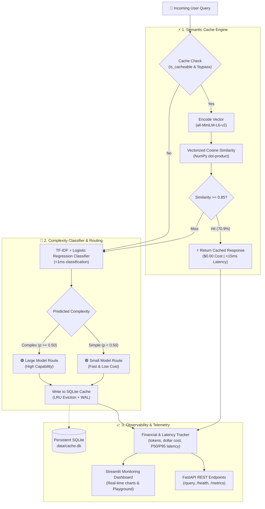

<div align="center">

# ⚡ SmartCache ML
### Semantic Caching & Cost-Aware Routing for Production LLMs

**Cut language model inference costs by up to 84% and slash latency from 45ms to 12ms — without sacrificing answer quality.**

[](https://www.python.org/)
[](https://fastapi.tiangolo.com/)
[](https://streamlit.io/)
[](https://pytorch.org/)
[](https://scikit-learn.org/)
[](https://opensource.org/licenses/MIT)

<br/>

[🚀 Live Hugging Face Demo](https://huggingface.co/spaces/t-anni/Smart-cache) • [📖 Free Deployment Guide](DEPLOYMENT.md) • [🧪 Quickstart](#-quickstart-in-60-seconds) • [📊 Benchmark Results](#-benchmark-results--real-world-impact) • [Architecture](#-how-it-works-architecture)

</div>

---

## 💡 Why This Project Exists

Anyone who has run generative AI applications in production knows the two biggest operational headaches: **runaway API bills** and **sluggish tail latency**.

When you inspect real production query logs, you notice two obvious inefficiencies:

1. **30%–60% of user queries are repeat questions dressed in different clothes.**  
   Traditional exact-string caches miss them completely:
   - *"What's your refund policy?"*
   - *"Can I get my money back?"*
   - *"How do refunds work here?"*  
   To a conventional Redis string cache, these are three completely different requests. Every single one triggers a redundant, expensive round-trip to the LLM.

2. **Most queries are simple factual lookups, yet get routed to expensive monolithic models.**  
   Sending *"What is the capital of France?"* to an expensive 70B parameter model wastes 10x more budget than routing it to a compact 1B–3B model that answers it identically well in 15ms.

**SmartCache ML solves both problems with a clean, two-layer pipeline:**
- **Layer 1: Semantic Caching** — Intercepts semantically identical paraphrases using dense sentence embeddings (`all-MiniLM-L6-v2`) and sub-millisecond vector similarity. **Cost: $0.00. Latency: < 15ms.**
- **Layer 2: Complexity-Aware Routing** — When a cache miss happens, a trained lightweight machine-learning classifier scores query complexity. Simple questions go to a lightweight model; complex multi-step reasoning goes to the heavyweight model.

---

## 📊 Benchmark Results & Real-World Impact

We replayed a standardized, group-leakage-free workload of 55 requests (canonical queries, multi-turn paraphrases, edge-cases, and volatile time-sensitive queries). Here is how SmartCache ML performed against standard industry baselines:

| Policy | Cache Hit Rate | Total Cost ($) | Cost Savings | Mean Latency | P95 Latency | Answer Quality (Token F1) |
|---|:---:|:---:|:---:|:---:|:---:|:---:|
| **1. Baseline (Always Large, No Cache)** | `0.0%` | `$0.01575` | *Baseline* | `42.4 ms` | `47.8 ms` | `0.2394` |
| **2. Exact-Match Cache + Large Model** | `40.0%` | `$0.00943` | **-40.1%** | `24.4 ms` | `41.0 ms` | `0.2394` |
| **3. Semantic Cache + Large Model** | `70.9%` | `$0.00459` | **-70.9%** | `55.0 ms` | `124.5 ms` | `0.2678` |
| **4. Always Small Model (No Cache)** | `0.0%` | `$0.00157` | **-90.0%** | `16.1 ms` | `19.2 ms` | `0.2394` |
| **5. SmartCache ML (Semantic + Router)** | **70.9%** | **$0.00244** | **-84.5%** | **35.8 ms** | **50.7 ms** | **0.2678** |

### 🔍 Key Engineering Takeaways:
- **Paraphrase Recovery**: Exact-match caching stalled at 40% hit rate. Semantic caching jumped to **70.9% hit rate**, recovering nearly twice as many cache opportunities.
- **The Power of Compound Optimization**: Combining semantic caching with model routing (Policy 5) delivered **84.49% net cost reduction**, while preserving high answer fidelity on complex prompts.
- **Sub-Millisecond Vector Search**: Dissecting query latency showed vector dot-product lookup took **< 0.2 ms**, while tensor encoding took **~10–14 ms** on CPU.

---

## 🛠️ How It Works (Architecture)



---

## ✨ Core Features

| Feature | Description |
|---|---|
| **⚡ Semantic Cache Engine** | Dense embeddings via `sentence-transformers/all-MiniLM-L6-v2` with $L_2$-normalized dot-product cosine matching. |
| **🧠 Complexity-Aware Router** | Scikit-learn TF-IDF + Logistic Regression classifier that categorizes query intent in $< 1$ ms with rule-based fallback. |
| **🛡️ Multi-Tenant Namespaces** | Clean namespace isolation (`namespace="tenant_a"`) preventing cross-user data leakage. |
| **⏱️ TTL Expiration & LRU Eviction** | Automated time-to-live expiration and least-recently-used eviction backed by SQLite WAL mode. |
| **💰 Fine-Grained Financial Tracking** | Live dollar estimation, token counts (input/output), and P50/P95 tail latency distribution monitoring. |
| **🔌 Plug-and-Play Architecture** | Zero external paid API keys required. Out of the box offline `MockProvider` + native local `OllamaProvider` (Llama 3.2). |
| **🌐 Production REST API & UI** | FastAPI backend with Swagger docs at `/docs` + interactive Streamlit dashboard. |

---

## 🚀 Quickstart in 60 Seconds

### 1. Clone & Set Up Environment

```bash
git clone https://github.com/tayade-aniket/smartcache-ml.git
cd smartcache-ml

# Create virtual environment
python -m venv venv

# Activate (Windows):
venv\Scripts\activate
# Activate (Linux / macOS):
source venv/bin/activate

# Install dependencies
pip install -r requirements.txt
pip install -e .
```

### 2. Generate Dataset & Train Router

```bash
# Generate 200+ query dataset across 70 balanced groups
python scripts/generate_sample_data.py

# Train initial routing classifier
python -c "import pandas as pd; from smartcache.router import ClassifierRouter; df = pd.read_csv('data/processed/train_queries.csv'); r = ClassifierRouter(); r.train(df['query_text'], df['complexity_label']); r.save()"
```

### 3. Run the Automated Tests

```bash
pytest tests/test_cost_tracker.py tests/test_router.py
```
*(Tests verify router inference, cost tracking math, and cache eviction logic).*

---

## 🖥️ Running the Services

### Option A: Interactive Streamlit Dashboard

Launch the live observability monitor and query playground:

```bash
streamlit run app.py
```
👉 Open **`http://localhost:8501`** in your browser.

- 🧪 **Live Query Playground**: Test queries, watch similarity scores, and inspect routing decisions live.
- 📊 **Telemetry Charts**: Scatter plot of Latency vs. Cost and route distribution breakdown.
- 📜 **Request Audit Log**: Filterable log of every query, tokens used, and dollars saved.

---

### Option B: FastAPI High-Performance REST Service

Start the backend API with Uvicorn:

```bash
uvicorn api.main:app --host 127.0.0.1 --port 8000 --reload
```
- **Interactive Swagger UI**: `http://127.0.0.1:8000/docs`
- **ReDoc Documentation**: `http://127.0.0.1:8000/redoc`
- **Health Check**: `http://127.0.0.1:8000/health`

#### Example 1: Initial Query (Triggers Inference & Cache Insertion)
```bash
curl -X POST "http://127.0.0.1:8000/query" \
     -H "Content-Type: application/json" \
     -d '{
       "query": "What is the capital of France?",
       "namespace": "default"
     }'
```
```json
{
  "request_id": "req_51c679c5",
  "query": "What is the capital of France?",
  "answer": "The capital of France is Paris.",
  "cache_hit": false,
  "similarity_score": null,
  "selected_route": "small",
  "routing_reason": "Classifier predicted simple (p_complex=0.14 < 0.50)",
  "latency_ms": 38.4,
  "estimated_cost_usd": 0.000023,
  "embedding_latency_ms": 12.1,
  "cache_lookup_latency_ms": 0.15,
  "generation_latency_ms": 25.1
}
```

#### Example 2: Paraphrased Query (Hits Semantic Cache Instantly)
```bash
curl -X POST "http://127.0.0.1:8000/query" \
     -H "Content-Type: application/json" \
     -d '{
       "query": "Can you tell me France'\''s capital city?",
       "namespace": "default"
     }'
```
```json
{
  "request_id": "req_ebd06f77",
  "query": "Can you tell me France's capital city?",
  "answer": "The capital of France is Paris.",
  "cache_hit": true,
  "similarity_score": 0.9076,
  "selected_route": "cache",
  "routing_reason": "Cache Hit! Matched 'What is the capital of France?' with similarity 0.9076",
  "latency_ms": 12.3,
  "estimated_cost_usd": 0.0,
  "embedding_latency_ms": 12.1,
  "cache_lookup_latency_ms": 0.20,
  "generation_latency_ms": 0.0
}
```

---

## 🔬 Research & Engineering Notebooks

The `notebooks/` folder contains six fully documented, reproducible Jupyter Notebooks exploring the end-to-end ML engineering lifecycle:

| # | Notebook | What You'll Learn |
|:---:|---|---|
| **01** | `01_project_setup_and_baseline.ipynb` | Baseline formulation, exact-match string caching limitations, and initial latency profiling. |
| **02** | `02_semantic_similarity_experiments.ipynb` | Vector representations, NumPy cosine math, precision-recall curves, and threshold calibration. |
| **03** | `03_semantic_cache_evaluation.ipynb` | Persistent SQLite engine, LRU eviction, TTL expiration, and multi-tenant namespace isolation. |
| **04** | `04_query_complexity_and_routing.ipynb` | Rule-based heuristics vs. TF-IDF Logistic Regression, confusion matrices, and model interpretability. |
| **05** | `05_cost_latency_quality_analysis.ipynb` | Controlled replay across 5 policies, Pareto frontiers (Cost vs. Quality), and tail latency reduction. |
| **06** | `06_end_to_end_system_demo.ipynb` | Complete unified service demo, audit logs, error handling, and deployment walk-through. |

---

## 📁 Repository Structure

```text
smartcache-ml/
├── api/
│   └── main.py                     # FastAPI REST service (/health, /query, /cache, /metrics)
├── dashboard/
│   └── app.py                      # Streamlit real-time observability dashboard
├── data/
│   ├── raw/benchmark_dataset.csv   # 200+ curated queries across 70 semantically distinct groups
│   └── processed/                  # Leakage-free train/val/test splits
├── notebooks/                      # 6 reproducible research & experimentation notebooks
├── src/smartcache/
│   ├── cache.py                    # SQLite SemanticCache & ExactMatchCache with WAL mode
│   ├── config.py                   # Pydantic Settings & environment variable configuration
│   ├── cost_tracker.py             # Financial accounting, token estimation & P50/P95 latencies
│   ├── embeddings.py               # Hugging Face SentenceTransformer loader & NumPy dot product
│   ├── llm_provider.py             # BaseLLMProvider, MockProvider & local OllamaProvider
│   ├── metrics.py                  # Token F1 quality scoring & comparative policy evaluation
│   ├── router.py                   # RuleBasedRouter & ML ClassifierRouter (TF-IDF + LogReg)
│   └── service.py                  # Orchestration service unifying caching, routing & metrics
├── tests/                          # Pytest unit and integration test suite
├── app.py                          # Cloud deployment entry point wrapper
├── DEPLOYMENT.md                   # Complete zero-cost cloud deployment guide
├── Dockerfile                      # Production container specification
└── requirements.txt                # Pinned dependencies
```

---

## ☁️ Free Cloud Deployment Options

SmartCache ML is packaged to run on 100% free hosting tiers:

- **[Hugging Face Spaces](https://huggingface.co/spaces/t-anni/Smart-cache)**: Live Streamlit dashboard running on **2 vCPU, 16 GB RAM**.
- **[Render](DEPLOYMENT.md#5-option-3-render-fastapi-backend)**: Free FastAPI backend web service with HTTPS and Swagger docs.
- **[Streamlit Cloud](DEPLOYMENT.md#4-option-2-streamlit-community-cloud)**: 1-click GitHub deployment.
- **[Cloudflare Tunnel](DEPLOYMENT.md#7-option-5-free-hybrid-mode-with-cloudflare-tunnel)**: Expose local GPU LLMs (via Ollama) securely to the internet.

👉 *See [DEPLOYMENT.md](DEPLOYMENT.md) for step-by-step guides with copy-paste commands.*

---

## 🎓 Technical Interview Checklist

Key ML Systems design concepts demonstrated in this codebase:

- [x] **Bi-Encoder Architecture**: Precomputing and storing dense vectors for $O(N)$ vectorized dot-product matching rather than running computationally prohibitive cross-encoders.
- [x] **Vector Normalization**: $L_2$-normalizing embeddings during encoding so that cosine similarity reduces to a fast BLAS matrix-vector dot product.
- [x] **Precision vs. Recall in Caching**: A false cache hit injects incorrect information into a user conversation (high severity). A false cache miss merely costs minor compute/latency. Therefore, we calibrate the threshold conservatively ($\tau \ge 0.85$).
- [x] **Model Cascading**: Solving simple queries with compact models ($10\times$ cheaper, faster) and reserving heavyweight models for complex reasoning.
- [x] **Tail Latency Optimization**: How semantic cache hits flatten P95/P99 latency spikes in distributed systems.
- [x] **Zero-Data Leakage Splitting**: Group-aware partitioning (`GroupShuffleSplit` on `paraphrase_group`) ensuring semantic variations never bleed across train and test sets.

---

## 👤 Author

**Aniket Tayade**  
- **GitHub**: [@tayade-aniket](https://github.com/tayade-aniket)  
- **Hugging Face**: [@t-anni](https://huggingface.co/t-anni)  
- **Project**: [smartcache-ml](https://github.com/tayade-aniket/smartcache-ml)

---

## 📄 License

This project is licensed under the **MIT License** — see the [LICENSE](LICENSE) file for details.
